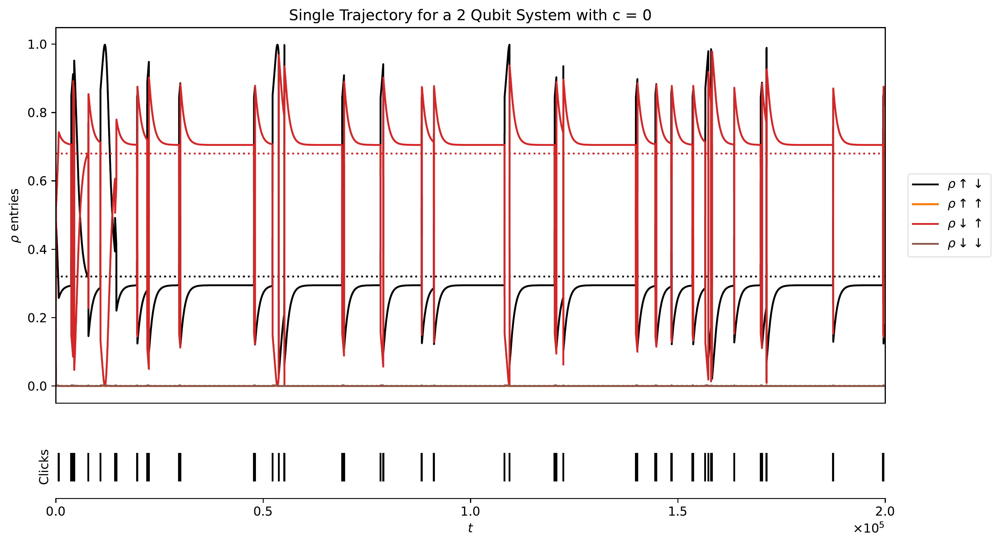
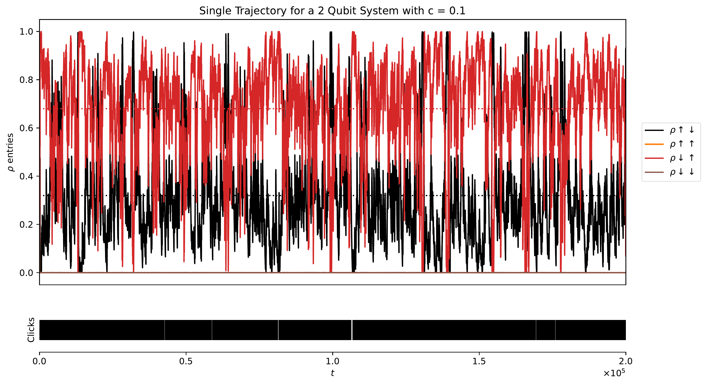
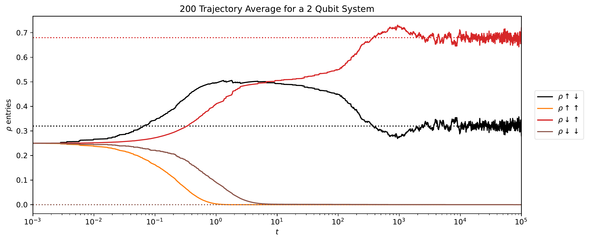
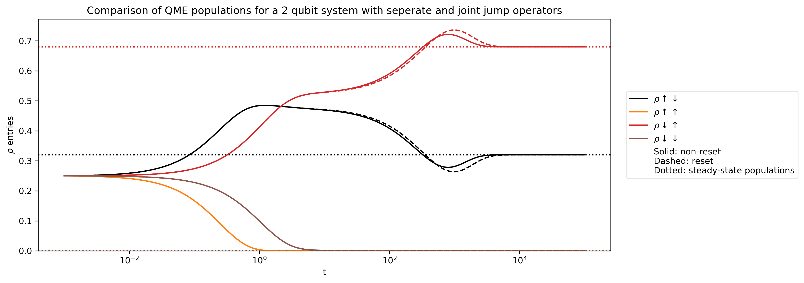
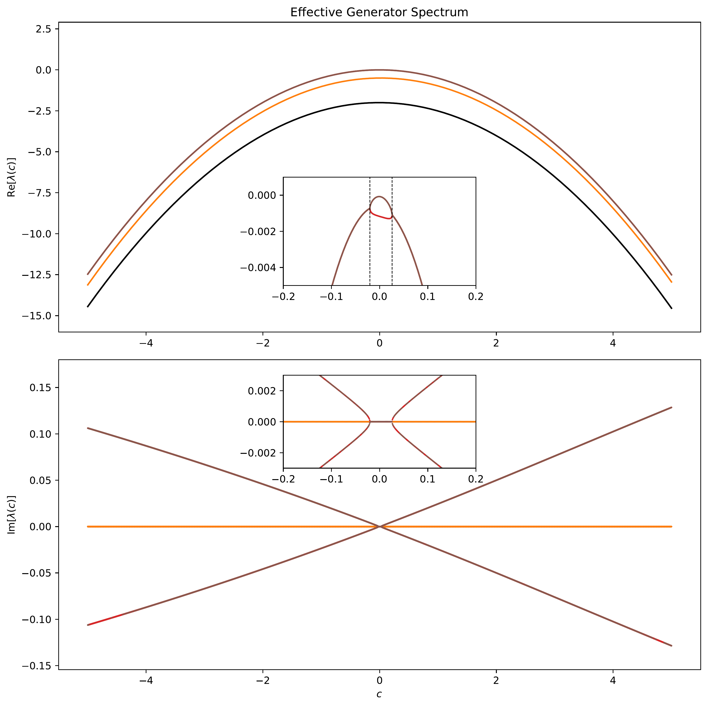
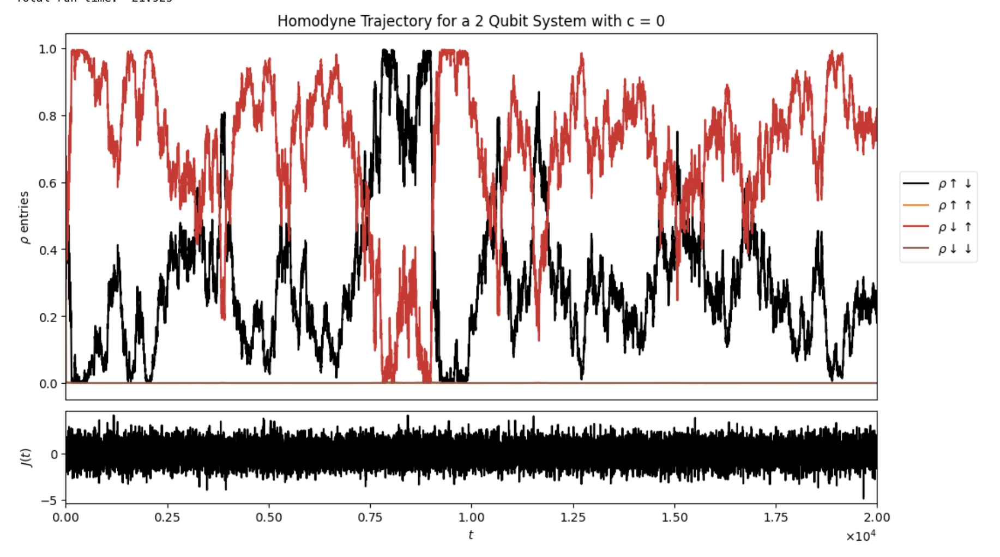

# Open Quantum Systems: Measurement-Dependent Quantum Trajectories

**Summer 2026 research internship | Jack Group, University of Cambridge**

## Overview

This project investigated how environmental measurement schemes affect the quantum trajectories of a driven, metastable two-qubit open quantum system. Although a Lindblad master equation specifies the evolution of the *unconditional* density matrix, monitoring the environment yields individual, stochastic, *conditioned* trajectories. Distinct measurement prescriptions can produce very different trajectories even when they give the same unconditional dynamics.

I explored quantum-jump and diffusive unravellings, changes to the measurement parameter, the distinction between separate and combined decay channels, and the spectral properties governing evolution between jumps.

### My contribution

I independently implemented and ran the numerical simulations, generated the figures, and analysed the results. I met with my supervisor weekly to discuss findings, assess interpretations, and identify the next questions to investigate.

**Tools:** Python, QuTiP, NumPy, SciPy and Matplotlib.

## Physical model

Assuming Markovian Lindblad dynamics and using units where $\hbar=1$, the unconditional density matrix evolves according to

```math
\frac{d\rho}{dt}=-i[H,\rho]+\sum_k\left(J_k\rho J_k^\dagger-\frac{1}{2}\{J_k^\dagger J_k,\rho\}\right).
```

The driven two-qubit model has Hamiltonian

```math
H=\Omega_1\sigma_1^y+\Omega_2\sigma_2^y,\qquad \Omega_i=\varepsilon\omega_i,
```

with two decay channels,

```math
J_1=\sqrt{\gamma_1}\,n_1\sigma_2^-,\qquad
J_2=\sqrt{\gamma_2}\,(1-n_1)\sigma_2^+.
```

Here $n_1$ projects onto the excited state of the first qubit. Each detected jump resets the state to one of two basis states. I studied the parameter choice $\omega_1=2$, $\omega_2=1$, $\gamma_1=4$ and $\gamma_2=1$, which exhibits metastable behaviour for sufficiently small driving scale $\varepsilon$.

## Numerical investigations and results

### 1. Changing the environmental measurement scheme

For a single jump channel, consider the transformation

```math
J_c=J+cI,\qquad
H_c=H+\frac{ic}{2}(J^\dagger-J),\qquad c\in\mathbb{R}.
```

This transformation leaves the Lindblad master equation unchanged, but significantly alters the conditioned quantum trajectories. Increasing the measurement parameter \(c\) increases the frequency of quantum jumps while reducing the change in the state associated with each jump. In the large-\(c\) limit, the jump rate scales as \(c^2\), while the state change per jump scales as \(1/c\). The system therefore undergoes increasingly frequent but smaller jumps, approaching diffusive behaviour.

This is illustrated by comparing individual trajectories at \(c=0\) and \(c=0.1\). Despite their very different appearances, both unravel the same unconditional master equation, as the transformation of the jump operator is accompanied by a compensating change in the Hamiltonian.

**Individual trajectories for $c=0$ and $c=0.1$:**





Averaging over independent stochastic trajectories approaches the unconditional master-equation solution. The following example averages 200 trajectories; residual differences reflect finite sampling.



### 2. Separate versus combined jump operators

I compared monitoring two channels with operators $J_1$ and $J_2$ against using one combined operator $J=J_1+J_2$. With separate channels, jumps reset the state to specific basis states; with the combined channel, the post-jump state may be a superposition.

Importantly, **combining the two operators is not the same as the gauge transformation above**. The dissipator of $J_1+J_2$ includes cross terms, so the unconditional dynamics can change. My simulations showed differences in transient coherences and populations, while the two models approached the same steady state for the parameters studied.



### 3. No-jump dynamics and generator spectra

Between detection events, the unnormalised state follows non-unitary evolution generated by an effective Hamiltonian:

```math
H_{\mathrm{eff}}=H_c-\frac{i}{2}J_c^\dagger J_c,\qquad
G=-iH_{\mathrm{eff}},\qquad
|\widetilde\psi(t)\rangle=e^{Gt}|\psi(0)\rangle.
```

I studied the spectrum of $G$ as the measurement parameter varied. Eigenvalues with the largest real parts govern the dominant long-time contributions to the no-jump evolution. When leading eigenvalues share the same real part, different imaginary parts can produce oscillatory rather than stationary asymptotic behaviour, provided the corresponding modes are populated.



[View an example no-jump path at c = 0.1](images/no_jump_path_c0p1.png)

### 4. Homodyne and heterodyne detection

I also investigated diffusive unravellings. In contrast to direct photon counting, **homodyne detection** continuously measures a field quadrature, producing noisy but continuous conditioned evolution. **Heterodyne detection** monitors two quadratures, introducing two noise components.

I compared these diffusive trajectories with jump-based trajectories at larger values of $c$.



[View additional trajectories at larger c](images/large_c_trajectories.png)

## Takeaway

The project highlighted the distinction between a system's unconditional density-matrix dynamics and the individual histories inferred from monitoring its environment. Measurement transformations may leave the Lindblad equation invariant while substantially changing trajectories, whereas combining physically distinct jump channels can modify the master equation itself. The spectrum of the effective non-Hermitian generator provides insight into the evolution between detected jumps.

*This repository presents selected figures and a summary of my computational research. The simulation source code is not included.*
