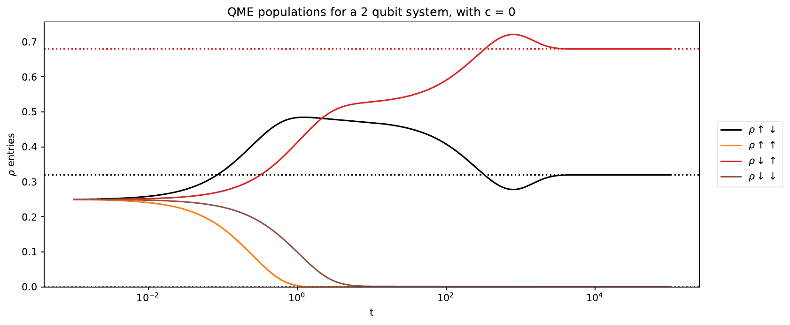

# Environmental Measurements and Quantum Trajectories in Metastable Open Systems

**Summer 2026 Research Internship | Jack Group, University of Cambridge**

## Overview

This project investigated how environmental measurement schemes affect the quantum trajectories of a driven, metastable two-qubit open quantum system. Although a Lindblad master equation specifies the evolution of the *unconditional* density matrix, monitoring the environment yields individual, stochastic, *conditioned* trajectories. Distinct measurement prescriptions can produce very different trajectories even when they give the same unconditional dynamics.

I explored quantum-jump and diffusive unravellings, changes to the measurement parameter, the distinction between separate and combined decay channels, and the spectral properties governing evolution between jumps.

### My contribution

I independently implemented and ran the numerical simulations, generated the figures, and analysed the results. I met with my supervisor weekly to discuss findings, assess interpretations, and identify the next questions to investigate.

**Tools:** Python, QuTiP, NumPy, SciPy and Matplotlib.

## Physical model

Assuming Markovian Lindblad dynamics and using units where $\hbar=1$, the unconditional density matrix evolves according to

```math
\frac{d\rho}{dt}=-i[H,\rho]+\sum_k\left(J_k\rho J_k^\dagger-\frac{1}{2}\{J_k^\dagger J_k,\rho\}\right).
```

The driven two-qubit model has Hamiltonian

```math
H=\Omega_1\sigma_1^y+\Omega_2\sigma_2^y,\qquad \Omega_i=\varepsilon\omega_i,
```

with two decay channels,

```math
J_1=\sqrt{\gamma_1}\,n_1\sigma_2^-,\qquad
J_2=\sqrt{\gamma_2}\,(1-n_1)\sigma_2^+.
```

Here $n_1$ projects onto the excited state of the first qubit. Each detected jump resets the state to one of two basis states. I studied the parameter choice $\omega_1=2$, $\omega_2=1$, $\gamma_1=4$ and $\gamma_2=1$, which exhibits metastable behaviour for sufficiently small driving scale $\varepsilon$.


The corresponding unconditional master-equation solution is shown below. Unlike individual quantum trajectories, the master-equation dynamics are independent of the measurement parameter \(c\), provided the Hamiltonian is transformed accordingly.




[View an example master-equation solution for c = -1](images/master_equation_c_minus1-1.png)

### Stochastic Schrödinger equation and MCWF method

To investigate individual conditioned trajectories, I used the Monte Carlo wave-function (MCWF) approach, which numerically unravels the master equation into realisations of a stochastic Schrödinger equation (SSE).

For the quantum-jump unravelling, the system evolves under a non-Hermitian effective Hamiltonian between randomly occurring detection events. The probability of a jump through channel \(k\) during an interval \(dt\) is

```math
dp_k = \langle\psi|J_k^\dagger J_k|\psi\rangle\,dt.
```

Following a detected jump, the wavefunction is updated according to

```math
|\psi\rangle \longrightarrow
\frac{J_k|\psi\rangle}
{\sqrt{\langle\psi|J_k^\dagger J_k|\psi\rangle}}.
```

Averaging over many independently sampled trajectories recovers the unconditional density matrix,

```math
\rho(t)=\mathbb{E}\left[|\psi(t)\rangle\langle\psi(t)|\right].
```

This provides a way to examine individual measurement-conditioned histories while retaining consistency with the Lindblad master equation.


## Numerical investigations and results

### 1. Changing the environmental measurement scheme

For a single jump channel, consider the transformation

```math
J_c=J+cI,\qquad
H_c=H+\frac{ic}{2}(J^\dagger-J),\qquad c\in\mathbb{R}.
```

This transformation leaves the Lindblad master equation unchanged, but significantly alters the conditioned quantum trajectories. Increasing the measurement parameter \(c\) increases the frequency of quantum jumps while reducing the change in the state associated with each jump. In the large-\(c\) limit, the jump rate scales as \(c^2\), while the state change per jump scales as \(1/c\). The system therefore undergoes increasingly frequent but smaller jumps, approaching diffusive behaviour.

This is illustrated by comparing individual trajectories at \(c=0\) and \(c=0.1\). Despite their very different appearances, both unravel the same unconditional master equation, as the transformation of the jump operator is accompanied by a compensating change in the Hamiltonian.

**Individual trajectories for $c=0$ and $c=0.1$:**


Averaging over independent stochastic trajectories approaches the unconditional master-equation solution. The following example averages 200 trajectories; residual differences reflect finite sampling.


### 2. Homodyne and heterodyne detection

I also investigated diffusive unravellings. In contrast to direct photon counting, **homodyne detection** continuously measures a field quadrature, producing noisy but continuous conditioned evolution. **Heterodyne detection** monitors two quadratures, introducing two independent noise components.


For ideal heterodyne detection, the conditioned state can be described by a diffusive stochastic Schrödinger equation (also known as quantum state diffusion). In Itô form,

```math
\begin{aligned}
d|\psi\rangle ={}&
\left[
-iH-\frac{1}{2}\sum_k
\left(
J_k^\dagger J_k
-2\langle J_k^\dagger\rangle J_k
+|\langle J_k\rangle|^2
\right)
\right]|\psi\rangle\,dt\\
&+\sum_k
\left(J_k-\langle J_k\rangle\right)
|\psi\rangle\,dZ_k.
\end{aligned}
```

Here, \(dZ_k\) are independent complex Wiener increments satisfying

```math
\mathbb{E}[dZ_k]=0,\qquad
\mathbb{E}[dZ_k\,dZ_l]=0,\qquad
\mathbb{E}[dZ_k\,dZ_l^*]=\delta_{kl}\,dt.
```

Each complex increment represents two independent real noise components, corresponding to measurements of the two field quadratures. Unlike quantum-jump trajectories, the resulting conditioned evolution is continuous but stochastic.


Importantly, the quantum-jump unravelling approaches homodyne detection in the large-\(c\) limit. As \(c\) increases, jumps become increasingly frequent but produce progressively smaller changes in the conditioned state. In the limit \(c\to\infty\), the compensated jump process converges to a diffusive unravelling corresponding to homodyne detection.
I compared these diffusive trajectories with jump-based trajectories at larger values of $c$.


[View additional trajectories at larger c](images/large_c_trajectories.png)


### 3. Separate versus combined jump operators

I compared monitoring two channels with operators $J_1$ and $J_2$ against using one combined operator $J=J_1+J_2$. With separate channels, jumps reset the state to specific basis states; with the combined channel, the post-jump state may be a superposition.

Importantly, **combining the two operators is not the same as the gauge transformation above**. The dissipator of $J_1+J_2$ includes cross terms, so the unconditional dynamics can change. My simulations showed differences in transient coherences and populations, while the two models approached the same steady state for the parameters studied.


### 4. No-jump dynamics and generator spectra

Between detection events, the unnormalised state follows non-unitary evolution generated by an effective Hamiltonian:

```math
H_{\mathrm{eff}}=H_c-\frac{i}{2}\sum_k J_{k,c}^\dagger J_{k,c},\qquad
G=-iH_{\mathrm{eff}},\qquad
|\widetilde\psi(t)\rangle=e^{Gt}|\psi(0)\rangle.
```

Since the dynamics preserve real amplitudes, the normalised two-qubit state can be represented as a point on the three-sphere \(S^3\), embedded in four-dimensional real space. Equivalently, three amplitudes specify a point inside a three-dimensional unit ball, with the fourth determined up to a sign by normalisation. Between jumps, the state evolves deterministically along a continuous path on this sphere, while detection events cause discontinuous jumps to new points.

I studied the spectrum of $G$ as the measurement parameter varied. Eigenvalues with the largest real parts govern the dominant long-time contributions to the no-jump evolution. When leading eigenvalues share the same real part, different imaginary parts can produce oscillatory rather than stationary asymptotic behaviour, provided the corresponding modes are populated.


[View an example no-jump path at c = 0.1](images/no_jump_path_c0p1.png)


## Takeaway

The project highlighted the distinction between a system's unconditional density-matrix dynamics and the individual histories inferred from monitoring its environment. Measurement transformations may leave the Lindblad equation invariant while substantially changing trajectories, whereas combining physically distinct jump channels can modify the master equation itself. The spectrum of the effective non-Hermitian generator provides insight into the evolution between detected jumps.


## Acknowledgements

I would like to thank Professor Rob Jack for his supervision and guidance throughout this research, and the Ian McDonald Fund at Trinity College, Cambridge, for its generous financial support.

*This repository presents selected figures and a summary of my computational research. The simulation source code is not included.*
